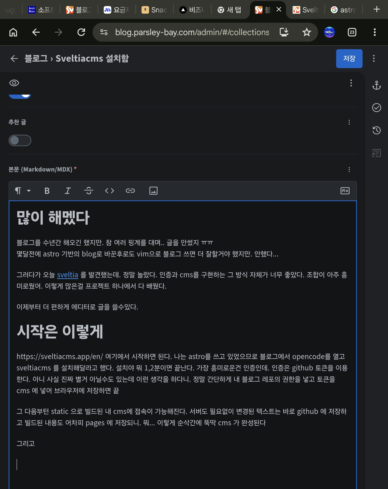

# 많이 해멨다

블로그를 수년간 해오긴 했지만. 참 여러 핑계를 대며.. 글을 안썼지 ㅠㅠ
몇달전에 astro 기반의 blog로 바꾼후로도 vim으로 블로그 쓰면 더 잘할거야 했지만. 안했다...

그러다가 오늘 [sveltia](https://sveltiacms.app/en/) 를 발견했는데. 정말 놀랐다. 인증과 cms를 구현하는 그 방식 자체가 너무 좋았다. 조합이 아주 흥미로웠어. 이렇게 많은걸 프로젝트 하나에서 다 배웠다. 

이제부터 더 편하게 에디터로 글을 쓸수있다.

# 시작은 이렇게

https://sveltiacms.app/en/ 여기에서 시작하면 된다. 나는 astro를 쓰고 있었으므로 블로그에서 opencode를 열고  sveltiacms 를 설치해달라고 했다. 설치야 뭐 1,2분이면 끝난다. 가장 흥미로운건 인증인데. 인증은 github 토큰을 이용한다. 아니 사실 진짜 별거 아닐수도 있는데 이런 생각을 하다니. 정말 간단하게 내 블로그 레포의 권한을 넣고 토큰을  cms 에 넣어 브라우저에 저장하면 끝

그 다음부턴 static 으로 빌드된 내 cms에 접속이 가능해진다. 서버도 필요없이 변경된 텍스트는 바로 github 에 저장하고 빌드된 내용도 어차피 pages 에 저장되니. 뭐... 이렇게 순삭간에 뚝딱 cms 가 완성된다

그리고 캡처하고 아래처럼 붙여넣으면 심지어 이미지도 들어온다. 정말... 좋은 너무나 사랑스러운 프로젝트 ㅠㅠ

이런 귀한걸 만들어주다니 감사합니다 ㅠㅠ 크흑...

사이트 좀 둘러봐야겠당
